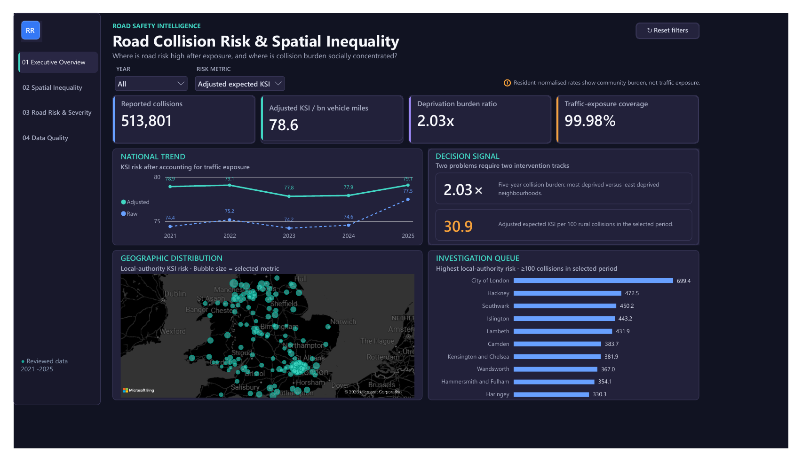
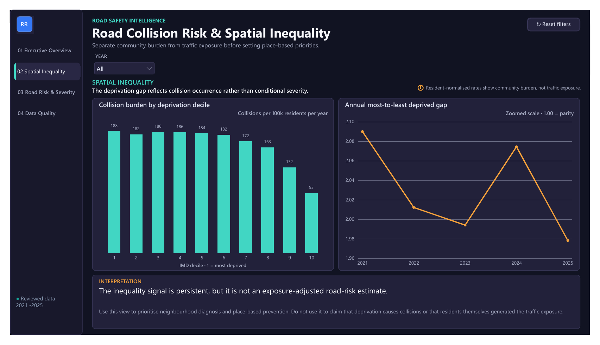
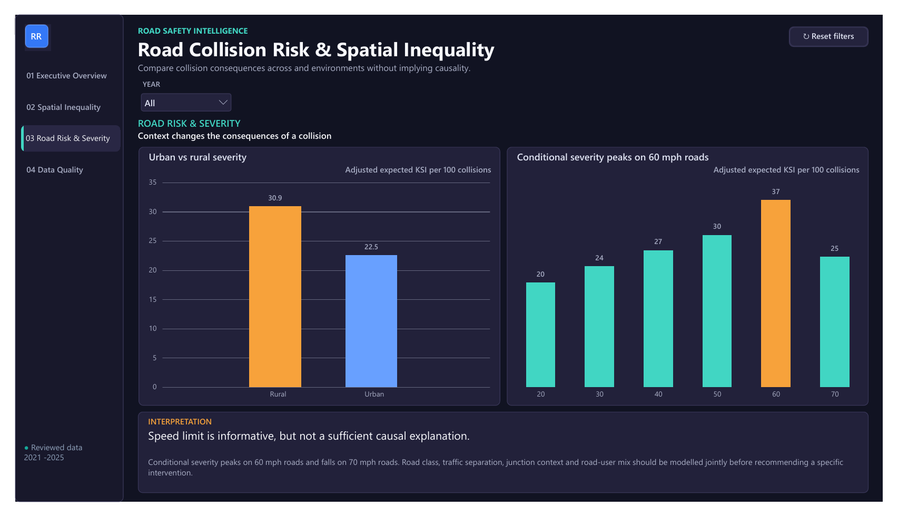
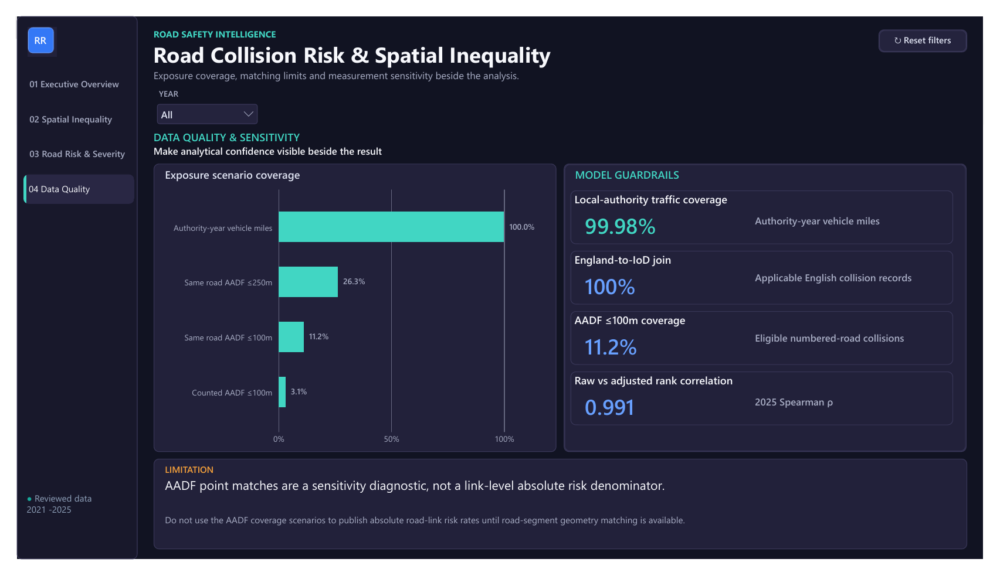

# Road Collision Risk & Spatial Inequality

An end-to-end geospatial analytics engineering project that combines official Great Britain road-collision, traffic-exposure, deprivation, and geography data to distinguish where collisions concentrate from where road risk remains high after accounting for exposure.

The project uses Python for reproducible ingestion and analysis, dbt/PostGIS-style models for transparent transformations, and a Power BI-ready star schema for decision-focused reporting.

## Power BI dashboard

The completed four-page report connects exposure-adjusted road risk, community collision burden, conditional severity, and data-quality guardrails in one decision-focused interface.

- [Open the dashboard PDF](powerbi/road_collision_risk_spatial_inequality.pdf)
- [Download the Power BI Desktop file](powerbi/road_collision_risk_spatial_inequality.pbix)
- [Review the DAX measures](powerbi/measures.dax)

### Executive overview



### Spatial inequality



### Road risk and severity



### Data quality and sensitivity



The `.pbix` file is designed for local use in Power BI Desktop. The PDF and preview images provide a static view of the completed report without requiring Power BI Service access.

## Why this project matters

Collision counts alone can overstate risk in places with more traffic and understate the social burden in deprived communities. This project separates three related questions:

1. Where are collisions concentrated?
2. Where is severe-collision risk high after accounting for vehicle miles?
3. Which communities experience a disproportionate collision burden?

This distinction supports different interventions: network safety investment, local enforcement, road-design reviews, and place-based public-health policy.

## Key findings

- The most deprived English LSOAs recorded **187.7 collisions per 100,000 residents per year**, compared with **92.5** in the least deprived decile: a **2.03x** concentration ratio. The annual ratio stayed between **1.98x and 2.09x** from 2021 to 2025.
- Conditional severity was not higher in the most deprived decile: adjusted expected KSI was **23.9 per 100 collisions** versus **25.3** in the least deprived decile. The inequality signal is therefore stronger in collision occurrence than in post-collision severity.
- In 2025, rural collisions had **31.7 adjusted expected KSI per 100 collisions**, compared with **24.3** in urban areas, indicating a distinct rural-severity problem.
- Across 2021–2025, adjusted expected KSI rose from **20.4 per 100 collisions** on 20 mph roads to **36.5** on 60 mph roads. The 70 mph value was lower than the 60 mph value, showing that speed limit alone is not a sufficient explanation; road design, traffic separation, and road-user mix also matter.
- Injury-based severity adjustment increased the national KSI rate by **6.0% in 2021** and **2.1% in 2025**. The 2025 local-authority ranking remained stable (Spearman **0.991**), so the adjustment changes levels more than the broad spatial ordering.

These are descriptive associations, not causal estimates. Resident population is used only as a social-context denominator, not as a substitute for road-use exposure.

## Architecture

```text
Official source files
  -> Python ingestion and schema checks
  -> staging tables
  -> conformed geography and collision context
  -> exposure and severity models
  -> validated analytical marts
  -> Power BI-ready star schema
```

## Data sources

- [UK Department for Transport (DfT) STATS19 road safety open data](https://www.gov.uk/government/statistical-data-sets/road-safety-open-data)
- [DfT road traffic statistics and annual vehicle miles](https://roadtraffic.dft.gov.uk/downloads)
- [Ministry of Housing, Communities and Local Government, English Indices of Deprivation 2025](https://www.gov.uk/government/statistics/english-indices-of-deprivation-2025)
- [Office for National Statistics Open Geography](https://geoportal.statistics.gov.uk/)

Raw source files are not committed to the repository. The ingestion scripts retain source metadata and make the workflow reproducible from the official releases.

Downloaded code lists and publisher workbooks are also excluded from version control. Reusers should obtain them from the official sources and follow each publisher's current licence and attribution terms.

## Repository structure

```text
data/metadata/       Source manifest and provenance metadata
data/public/         Small, publication-ready analytical extracts
assets/dashboard/    Static previews of the completed Power BI report
models/              dbt-style staging, intermediate, mart, and QA models
notebooks/           Executable audit and insight notebooks
powerbi/             PBIX report, PDF export, DAX, Power Query, and theme
reports/             Public English-language findings
src/                 Download, transformation, validation, and export code
```

## Reproduce the project

```powershell
python -m pip install -r requirements.txt
python src/download_stats19.py
python src/audit_stats19.py
python src/download_week2_geography.py
python src/build_week2_pipeline.py
python src/match_collisions_to_aadf.py
python src/build_powerbi_marts.py
python src/build_public_insights.py
python src/validate_week2_models.py
python src/validate_powerbi_marts.py
```

The official downloads are large. Intermediate data, raw files, local reports, and generated HTML are intentionally excluded from version control.

## Data-quality decisions

- Collision grain is one row per `collision_index`; local-authority risk grain is one authority-year.
- Historic LSOA codes are conformed to 2021 geography using the ONS best-fit lookup before joining deprivation.
- Local-authority vehicle miles are the default denominator for absolute risk comparisons.
- Injury-based severity adjustment is shown beside the raw reported metric rather than replacing it.
- AADF point matching is restricted to sensitivity analysis because only about 11% of eligible numbered-road collisions have a same-year, same-road count point within 100 metres.
- `Counted` and `Estimated` traffic observations remain distinguishable throughout the model.

## Power BI semantic model

The export contains three facts and conformed dimensions:

- `fact_collision`
- `fact_local_authority_year_risk`
- `fact_exposure_sensitivity`
- `dim_date`, `dim_year`, `dim_lsoa`, `dim_local_authority`, and `dim_exposure_scenario`

The model contract defines keys, grain, and relationships. The version-controlled DAX, Power Query templates, and report theme document the implementation used by the completed dashboard.

## Limitations

- The analysis is observational and does not identify causal effects.
- Resident-normalised collision rates describe community burden, not exposure-adjusted road risk.
- Point-based AADF matching cannot represent full road-link exposure without segment geometry.
- Deprivation is available for England only, while STATS19 covers Great Britain.
- Small-area results require careful suppression and uncertainty treatment before operational use.

## Project status

Complete. The repository includes the source audit, geographic integration, exposure modelling, sensitivity analysis, decision insights, validated Power BI semantic model, and final four-page dashboard.
